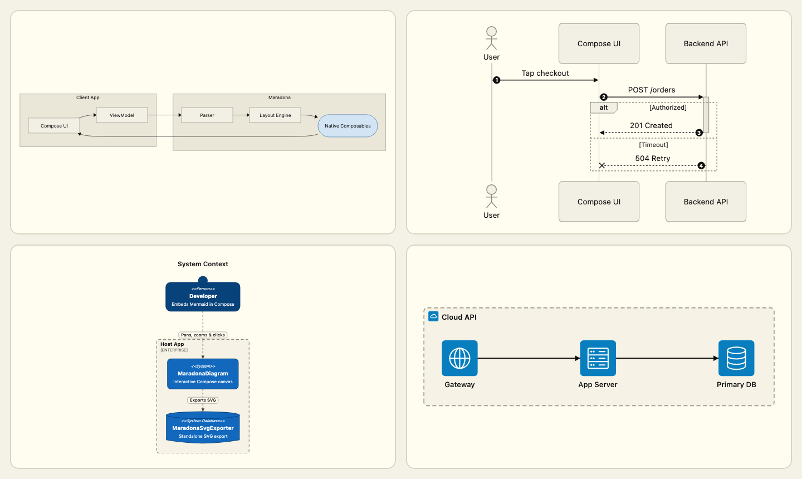
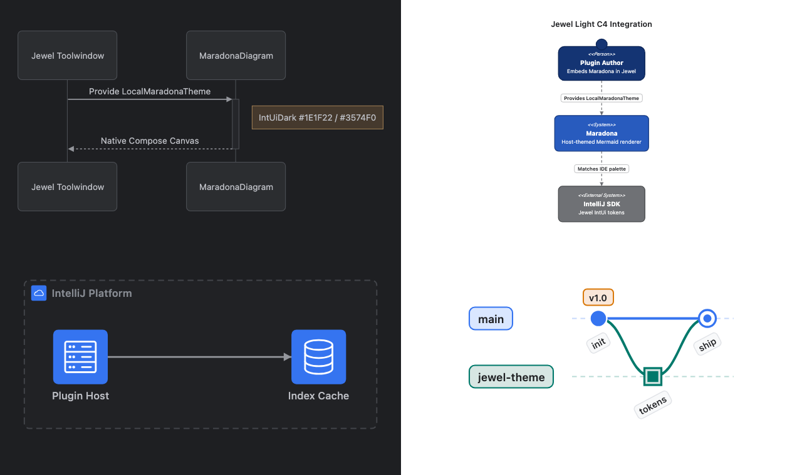

# Maradona

Maradona renders [Mermaid](https://mermaid.js.org) diagrams as native **Compose Multiplatform** composables on **Desktop (JVM)**, **Android**, and **iOS** — without a WebView or JavaScript runtime. It is inspired by [Pele](https://pele.run): fast Mermaid rendering that adapts to your application's theme, built for Compose instead of the browser.



## Highlights

- **All 23 Mermaid diagram families** parsed and laid out in pure Kotlin (`commonMain`), from Flowcharts, Sequence, Class, State, and ER diagrams to C4, Architecture, ZenUML, Gantt, Mindmap, Sankey, XY Chart, Radar, Packet, Kanban, and Treemap.
- **Interactive Compose UI:** pan, pinch/Ctrl+scroll zoom anchored at the pointer, double-tap to reset, `click` / `link` callbacks via `onNodeClick`, and per-node screen-reader accessibility traversal.
- **Live-editing resilience:** when the input text is mid-edit and temporarily fails to parse, Maradona keeps the last valid diagram visible (dimmed) and displays a compact error banner at the bottom.
- **Host-customizable theming:** built-in `light()`, `dark()`, `jewelLight()`, and `jewelDark()` presets plus `MaradonaTheme.fromHost(...)` and `LocalMaradonaTheme` so diagrams match IntelliJ/Jewel toolwindows, Material apps, or custom design systems.
- **Standalone SVG export:** `MaradonaSvgExporter.exportToSvg(source, theme)` produces standalone SVG strings across all 23 families without needing a Compose window.

---

## Try It in 30 Seconds

Clone the repository and launch the interactive desktop editor (which includes live examples for all 23 diagram families and theme switching):

```sh
./gradlew :sample-desktop:run          # Desktop live editor & diagram preview
./gradlew :sample-android:installDebug # Android sample app (requires ANDROID_HOME)
open iosApp/iosApp.xcodeproj           # iOS sample app (Apple Silicon simulator or device)
```

### Adding Maradona to Your Build

> **Release status:** Maradona is pre-release (`0.23`) and is **not yet published to Maven Central**. Consume it from source via a Gradle composite build (`includeBuild`):

```kotlin
// settings.gradle.kts
includeBuild("../maradona") {
    dependencySubstitution {
        substitute(module("dev.maradona:maradona")).using(project(":maradona"))
    }
}
```

```kotlin
// build.gradle.kts (commonMain or platform source set)
dependencies {
    implementation("dev.maradona:maradona")
}
```

---

## Quickstart

### 1. Render a Diagram (`MaradonaDiagram`)

```kotlin
import androidx.compose.foundation.layout.fillMaxSize
import androidx.compose.runtime.Composable
import androidx.compose.ui.Modifier
import dev.maradona.render.MaradonaDiagram
import dev.maradona.render.MaradonaTheme

@Composable
fun CheckoutFlowScreen() {
    MaradonaDiagram(
        source = """
            flowchart LR
              subgraph client[Client App]
                UI[Compose UI] --> VM[ViewModel]
              end
              subgraph engine[Maradona]
                P[Parser] --> L[Layout Engine]
                L --> R([Native Composables])
              end
              VM --> P
              R --> UI
        """.trimIndent(),
        theme = MaradonaTheme.light(), // or MaradonaTheme.dark(), jewelDark(), jewelLight()
        modifier = Modifier.fillMaxSize(),
    )
}
```

### 2. Theme & Jewel Integration (`LocalMaradonaTheme` & `MaradonaTheme.fromHost`)

Provide `LocalMaradonaTheme` once for a subtree, use the built-in JetBrains Jewel presets (`MaradonaTheme.jewelDark()` / `MaradonaTheme.jewelLight()`), or derive a full palette and typography scale from your host application's design tokens with `MaradonaTheme.fromHost(...)`:



```kotlin
import androidx.compose.runtime.CompositionLocalProvider
import androidx.compose.ui.graphics.Color
import androidx.compose.ui.unit.sp
import dev.maradona.render.LocalMaradonaTheme
import dev.maradona.render.MaradonaDiagram
import dev.maradona.render.MaradonaTheme

// Option A: Built-in JetBrains Jewel (IntUiDark / IntUiLight) presets
CompositionLocalProvider(LocalMaradonaTheme provides MaradonaTheme.jewelDark()) {
    MaradonaDiagram(source = mermaidSource)
}

// Option B: Derive all diagram tokens from your host theme's surfaces and accents
val hostTheme = MaradonaTheme.fromHost(
    background = Color(0xFF1E1F22),
    surface = Color(0xFF2B2D30),
    border = Color(0xFF4E5157),
    text = Color(0xFFBCBEC4),
    accent = Color(0xFF3574F0),
    baseFontSize = 13.sp,
)
CompositionLocalProvider(LocalMaradonaTheme provides hostTheme) {
    MaradonaDiagram(source = mermaidSource)
}
```

### 3. Handle Node Clicks & Links (`onNodeClick`)

```kotlin
import dev.maradona.render.MaradonaDiagram

MaradonaDiagram(
    source = """
        flowchart LR
          Spec[Design Spec] --> PR[Pull Request]
          click Spec "https://example.com/spec" "Open design spec"
          click PR call openPullRequest("42") "Review PR #42"
    """.trimIndent(),
    onNodeClick = { event ->
        // event.nodeId, event.label, event.url, event.callback, event.tooltip
        println("Clicked ${event.nodeId}: url=${event.url}, callback=${event.callback}")
    },
)
```

### 4. Export Standalone SVG (`MaradonaSvgExporter`)

```kotlin
import dev.maradona.export.MaradonaSvgExporter
import dev.maradona.render.MaradonaTheme

val svgString: String = MaradonaSvgExporter.exportToSvg(
    source = mermaidSource,
    theme = MaradonaTheme.light(),
)
```

---

## Supported Diagram Families (All 23)

See [`docs/diagram-syntax.md`](docs/diagram-syntax.md) for the complete syntax and directive reference for every family.

| Diagram Family | Mermaid Header Keywords | Highlights |
| --- | --- | --- |
| **Flowchart** | `flowchart`, `graph` (`TD`/`TB`, `BT`, `LR`, `RL`) | 12 node shapes, v2 `@{ shape }` metadata, nested subgraphs, `click`, `style` / `classDef` |
| **Sequence** | `sequenceDiagram` | `participant` & `actor`, activations (`+`/`-`), `loop`/`alt`/`opt`/`par`/`critical`/`break`/`rect`/`box`, `Note`, `autonumber` |
| **Class** | `classDiagram`, `classDiagram-v2` | Generics (`~T~`), stereotypes, visibility & static/abstract classifiers, UML relations, lollipop interfaces, `namespace` |
| **State** | `stateDiagram`, `stateDiagram-v2` | Composite states, concurrent `--` regions, `[*]` start/end, `<<choice>>`, `<<fork>>`, `<<join>>`, notes |
| **Entity-Relationship** | `erDiagram` | Crow's-foot & natural-language cardinalities, `{ type name PK/FK/UK "comment" }` tables, nested `subgraph` |
| **Mindmap** | `mindmap` | Indentation tree, 7 node shapes, `::icon(...)`, `:::class`, multi-line markdown labels |
| **Gantt** | `gantt` | `section`, `done`/`active`/`crit`/`milestone`/`vert`, `after`/`until` dependencies, `excludes weekends`, `compact` mode |
| **Pie** | `pie`, `pie showData` | Percentage slices, configurable `donutHole`, `highlightSlice` explosion, legend |
| **GitGraph** | `gitGraph` (`LR`, `TB`, `BT`) | `commit` (`NORMAL`/`REVERSE`/`HIGHLIGHT`), `branch`, `checkout`, `merge`, `cherry-pick`, tags |
| **Timeline** | `timeline` | `section`, multi-era periods, stacked event cards |
| **User Journey** | `journey` | `section`, task score tracks (`1`–`5`), actor dots & legend, satisfaction mood faces |
| **Quadrant Chart** | `quadrantChart` | 4 labeled quadrants, rotated Y-axis titles, normalized `[x, y]` points, `classDef` point styling |
| **XY Chart** | `xychart`, `xychart-beta` | Vertical & horizontal orientations, grouped `bar` series, `line` series with point labels |
| **Kanban** | `kanban` | Columns, task cards with `@{ ticket, assigned, priority, icon }`, `ticketBaseUrl` links |
| **Sankey** | `sankey`, `sankey-beta` | RFC-4180 CSV flows, proportional node bars, gradient/source/target Bezier ribbons |
| **Requirement** | `requirementDiagram` | 6 requirement stereotypes + `element`, risk & verify badges, `contains` (`⊕`) & trace relationships |
| **Packet** | `packet`, `packet-beta` | Bit-range (`0-15`), single-bit, and relative (`+8`) fields, automatic `bitsPerRow` word wrapping |
| **Radar** | `radar`, `radar-beta` | Radial axes, polygon & circle graticules, multi-curve overlays, legend |
| **Block** | `block`, `block-beta` | `columns N`, column spans, nested composite blocks, 15 block shapes & directional block arrows |
| **Architecture** | `architecture`, `architecture-beta` | `group`, `service`, `junction`, vector icons (`cloud`, `database`, `disk`, `internet`, `server`), port-to-port edges |
| **Treemap** | `treemap`, `treemap-beta` | Hierarchical sections & valued leaves, squarified proportional tile layout |
| **C4** | `C4Context`, `C4Container`, `C4Component`, `C4Dynamic`, `C4Deployment` | `Person`, `System`, `Container`, `Component`, `_Db`/`_Queue`/`_Ext`, nested boundaries, `Rel` / `RelIndex` |
| **ZenUML** | `zenuml` | `@Actor`/`@Boundary`/`@Database` stereotypes, nested call blocks, `if`/`else`/`while`/`try`/`catch`, `//` comments |

---

## Supported Targets & How It Works

| Target | Gradle Target | Notes |
| --- | --- | --- |
| **Desktop (JVM)** | `jvm("desktop")` | macOS, Linux, Windows via Compose Multiplatform Desktop |
| **Android** | `android` (`minSdk = 24`, `compileSdk = 37`) | Standard Android Compose UI |
| **iOS** | `iosArm64()`, `iosSimulatorArm64()` | Apple Silicon devices and simulators |

All library code lives in `commonMain` across three layers:

1. **Parser (`dev.maradona.parse.MaradonaParser`)** — Pure Kotlin. Detects the diagram header/frontmatter and parses the source into a typed `MaradonaDiagramModel` without Compose dependencies.
2. **Layout (`dev.maradona.layout.*`)** — Pure Kotlin. Measures and positions nodes, containers, and edge routes (using a multiplatform port of Dagre/Sugiyama for directed graphs and dedicated layout engines for sequence, tree, timeline, chart, and grid families).
3. **Render & Export (`dev.maradona.render.MaradonaDiagram`, `dev.maradona.export.MaradonaSvgExporter`)** — Compose Multiplatform layouts that measure real composable nodes (preserving native text shaping, click hit-testing, and accessibility semantics), draw underlay splines/containers on a single canvas layer, or export standalone SVG.

---

## Maturity, Performance & Known Limitations

- **Pre-release status:** Maradona is not yet published to Maven Central; APIs may evolve before `1.0`.
- **Structural vs. pixel parity with `mermaid.js`:** Flowchart layout ports Dagre's ranking, crossing reduction, and Brandes–Köpf coordinate assignment (`<= 5%` node size and `<= 2%` centre tolerance against `mermaid.js`), while the other 22 families use independent pure-Kotlin layout engines. Renders are structurally faithful and verified across 71 fixtures on Desktop, Android, and iOS, not pixel-identical to Chromium `mermaid.js`.
- **Large diagram scalability:** Inputs are capped at `50,000` characters, `5,000` nodes, and `5,000` edges. When zoomed in (`viewportCullingEnabled = true`, the default), Maradona lazily composes only on-screen nodes and culls off-screen underlay edges while keeping cross-viewport edges intact (~2.6 ms/frame when panning a 400-node graph). When zoomed out so that thousands of nodes are simultaneously visible inside the viewport, layout and frame times remain CPU-bound.

---

## Documentation

- [**Supported Mermaid Syntax Reference (`docs/diagram-syntax.md`)**](docs/diagram-syntax.md) — Per-family syntax, directives, and styling options across all 23 families.
- [**Theming, Interaction & SVG Export (`docs/theming-and-integration.md`)**](docs/theming-and-integration.md) — `MaradonaTheme`, `LocalMaradonaTheme`, `fromHost`, `onNodeClick`, `LocalMaradonaImageResolver`, and `MaradonaSvgExporter`.
- [**Oracle Verification & Testing (`docs/oracle-and-testing.md`)**](docs/oracle-and-testing.md) — Running unit tests, screenshot smoke tests, and the 71-fixture × 3-platform visual & layout oracle.

## License

Apache License 2.0 — see [LICENSE](LICENSE).
